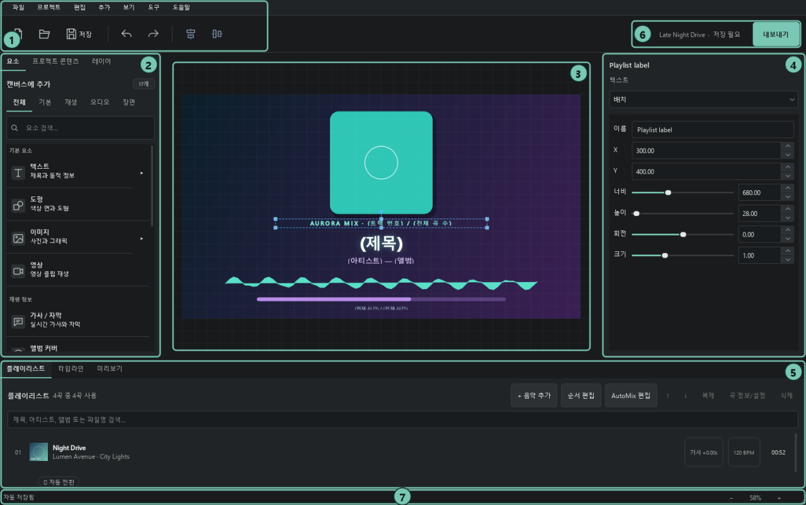
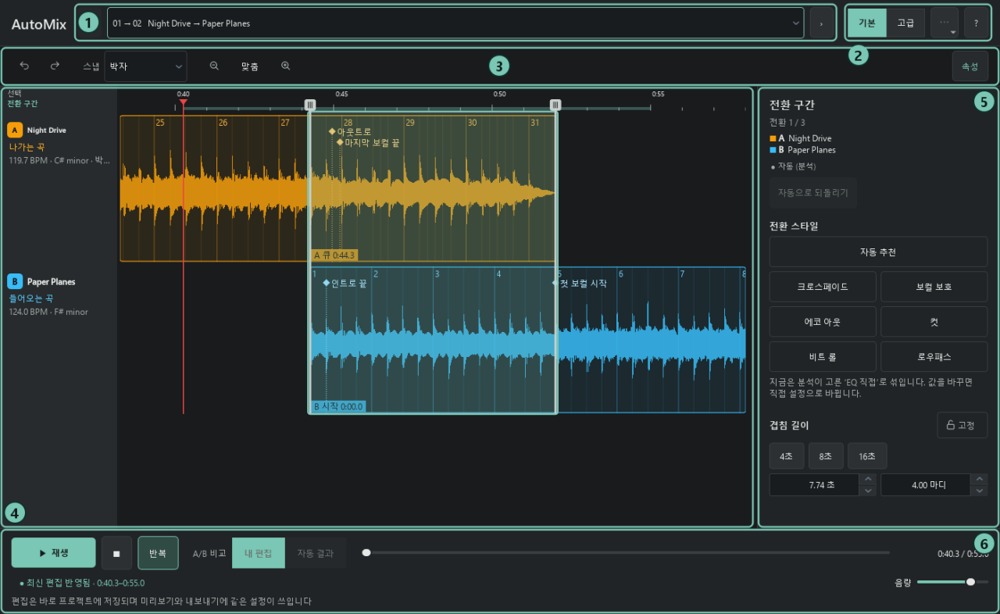

> 이전 이름은 **Playlist Canvas(플레이리스트 캔버스)** 입니다. 기존 `.pvsproj`·JSON 프로젝트를 그대로 열 수 있으며, 이전 앱의 설정·최근 프로젝트 목록·복구 파일은 첫 실행 때 이어받습니다. 설치한 FFmpeg·프리셋·언어팩은 기존 저장 위치를 계속 사용합니다. 최신 릴리즈와 업데이트는 새 GitHub 저장소에서 제공하며, 기존 Playlist Canvas 저장소는 구버전 배포용으로 유지합니다.

<div align="center">
  
  <h1>Music Motion Studio</h1>
  <p><b>좋아하는 음악에 가사와 움직이는 화면을 더해, 나만의 플레이리스트 영상을 만드세요.</b></p>
  <p>
    
    
    
  </p>
  <p>
    <a href="https://github.com/tharu8813/Music-Motion-Studio/releases/latest"><b>Windows용 다운로드</b></a> ·
    <a href="#다운로드와-설치">설치 방법</a> ·
    <a href="https://github.com/tharu8813/Music-Motion-Studio/issues">문제 신고·기능 제안</a>
  </p>
</div>

**Music Motion Studio는 PC에 있는 음악, 이미지, 영상과 가사를 조합해 플레이리스트 영상을 만드는 무료 Windows 프로그램입니다.** MP4·MOV·MKV 영상, 오디오만 저장하기, LRC·SRT 자막 내보내기를 지원합니다. 디자인 프리셋을 골라 시작하고, 화면에서 요소를 끌어 배치한 뒤 음악과 함께 미리보며 완성할 수 있습니다. 코딩 지식이나 별도의 Python 설치는 필요하지 않습니다.

**이 프로젝트는 ChatGPT Codex와 Claude Code를 활용하는 바이브코딩(Vibe Coding) 프로젝트입니다.** 사람이 아이디어와 제작 방향을 정하고, AI와 대화하며 프로그램을 구현합니다.



## 예시 영상

- 가사/자막, 오디오 비쥬얼라이저등의 요소를 활용한 [영상](https://www.youtube.com/watch?v=q3IhKdsTLmM), [영상](https://www.youtube.com/watch?v=0IIgeVMZ3TI)
- AutoMix을 활용한 [영상](https://www.youtube.com/watch?v=k2-e5Nhj7RY)

## 어떤 영상을 만들 수 있나요?

| 만들고 싶은 영상 | 사용할 수 있는 기능 |
| --- | --- |
| 여러 곡을 이어 듣는 플레이리스트 | 음악 순서 편집, 곡 제목·아티스트·앨범 커버 자동 표시, 트랙 목록과 진행 막대 |
| 노래에 맞춰 가사가 나오는 영상 | LRC·SRT·VTT 불러오기, 가사 타이밍 편집, 현재 줄 강조와 자막 애니메이션 |
| 음악에 반응하는 비주얼 영상 | 막대·원형 비주얼라이저, 파형, 레벨 미터, 파티클, 음악에 반응하는 글자와 앨범 커버 |
| 분위기 있는 배경 영상 | 이미지·영상·텍스트·도형 배치, 곡마다 다른 영상, 등장·퇴장과 반복 애니메이션 |
| 곡이 자연스럽게 이어지는 믹스 | 크로스페이드, AutoMix 자동 전환, 전환 구간 직접 편집, 곡별 음량·EQ 조절 |
| 가로·세로·정사각형 영상 | 화면 비율 선택, 사용자 지정 크기, HD부터 4K까지 MP4 내보내기 |

### 프리셋으로 시작하고 내 취향대로 꾸미기

오로라, 카세트, 미드나잇, 바이닐, 노래방, 플로우, 시네마 자막, 네온 나이트 등 디자인 프리셋을 제공합니다. 미리보기로 분위기를 고른 뒤 배경, 글꼴, 색상과 배치를 바꿀 수 있습니다.

이미지·영상·글자·도형을 여러 겹으로 쌓고 위치와 크기를 조절하세요. 곡이 바뀌면 앨범 커버와 곡 정보가 함께 바뀝니다. 타임라인에서는 요소가 나타나는 시점과 표시 길이를 정할 수 있습니다.

모든 요소의 **속성 → 모양**에서 좌우·상하 반전과 장식 프레임의 두께·색상·안쪽 여백을 조절할 수 있습니다. **프레임 디자인 적용**에서 클린 라인·여백 프레임·시안 포인트·파스텔·볼드 포스터를 고르고 세부 값을 바꾸세요. 여러 요소를 선택하면 공통 속성과 프레임 디자인을 함께 적용합니다. 도형은 삼각형·다이아몬드·육각형·별·하트·아치·알약 모양을 지원하고, 반복 모션에는 타원 궤도·좌우 떨림·끄덕이기·깜빡임을 제공합니다. 영상 요소의 등장·퇴장 효과는 없음·페이드만 지원하며 반복 모션은 지원하지 않습니다.


### 곡 사이를 연결하는 AutoMix

AutoMix는 곡의 박자, 조성, 보컬 구간과 분위기를 분석해 전환 위치와 방식을 자동으로 정합니다. 두 곡의 파형을 보면서 겹치는 길이와 시작 지점을 직접 바꾸고, 전환 구간을 반복해서 들을 수 있습니다. 자동 결과와 내 편집을 **A/B 비교**하고, 마음에 드는 설정은 프리셋으로 저장할 수 있습니다.



**AutoMix는 베타 기능입니다.** 첫 분석에는 시간이 필요하고 음악에 따라 결과가 달라지므로, 내보내기 전에 전체 믹스를 들어 보세요. 분석은 PC 안에서 진행하며 결과를 저장해 재사용합니다. 간단히 곡을 겹치려면 크로스페이드, 곡을 순서대로 재생하려면 전환 없음을 선택할 수 있습니다.


## 설치 전에 확인하세요

| 항목 | 안내 |
| --- | --- |
| 운영체제 | Windows 64비트용입니다. 기준 환경은 Windows 11입니다. |
| 사용 언어 | 한국어·영어를 지원합니다. |
| 준비할 파일 | PC에 저장된 음악 파일을 준비하세요. 이미지·영상·가사는 원하는 경우 추가합니다. |
| 필요한 구성요소 | 영상 내보내기와 믹스 미리보기 등에 FFmpeg가 필요합니다. 앱 안에서 다운로드하고 설치할 수 있습니다. |
| 인터넷 연결 | 프로그램·FFmpeg 다운로드와 업데이트 확인에 필요합니다. 설치 후 로컬 파일로 편집·분석·내보내기할 수 있습니다. |
| 작업 시간과 공간 | 긴 영상, 많은 효과, 4K·높은 프레임 레이트는 더 많은 시간과 저장 공간을 사용합니다. 내보내기 창에서 예상 필요 공간을 확인할 수 있습니다. |

이 프로그램은 **직접 준비한 음악 파일로 영상을 만드는 도구**입니다. M3U·M3U8 목록도 로컬 음악 파일을 가져오는 용도로 사용하며, 웹 스트리밍 주소는 건너뜁니다. 화면에 추가한 영상 클립의 소리는 사용하지 않고, 최종 영상의 음악은 플레이리스트로 구성합니다.

## 다운로드와 설치

1. [공식 다운로드 페이지](https://github.com/tharu8813/Music-Motion-Studio/releases/latest)를 엽니다.
2. **Assets**에서 이름이 `setup.exe`로 끝나는 Windows 설치 파일을 받습니다. 파일명 예시는 `Music.Motion.Studio-1.4.0.1-setup.exe`입니다. `Source code`는 소스 코드 압축 파일입니다.
3. 설치 파일을 실행해 언어와 설치 위치를 선택한 뒤, 시작 메뉴나 바탕 화면에서 **Music Motion Studio**를 엽니다.
   기본 설치 위치는 `%ProgramFiles%\Music Motion Studio`이며 설치 시 관리자 권한을 요청합니다.
4. 프로그램의 **도구 → 설정 → FFmpeg**에서 **(권장)** 버전을 고르고 **선택 버전 다운로드 및 설치**를 누릅니다. 다운로드와 설치가 끝나면 자동으로 적용됩니다.

FFmpeg는 음악과 화면을 합쳐 영상 파일로 만드는 구성요소이며, 프로그램 설치 파일에는 포함되지 않습니다. **MP4 내보내기, 내보내기 품질의 믹스 미리보기, 박자 기반 AutoMix 분석·미리듣기와 EQ 미리듣기**를 사용하려면 설치해 주세요. 기본 크로스페이드 미리보기는 FFmpeg 없이도 바로 재생하며, AutoMix 준비 중에도 기본 크로스페이드로 연결합니다. 이미 설치한 FFmpeg가 있다면 같은 설정 화면에서 `ffmpeg.exe`를 지정할 수 있습니다.

## 첫 영상 만들기

1. **새 프로젝트 만들기** — 이름, 화면 비율과 디자인 프리셋을 고릅니다. 일반 가로 영상은 16:9, 세로 영상은 9:16으로 시작할 수 있습니다.
2. **음악 추가하기** — 음악 파일을 플레이리스트에 넣고 원하는 순서로 정렬합니다. 곡 전환은 없음·크로스페이드·AutoMix 중에서 선택합니다.
3. **화면 꾸미기** — 요소 탭에서 배경, 앨범 커버, 제목, 가사와 비주얼라이저를 추가합니다. 캔버스에서 끌어 배치하고 오른쪽 속성에서 모양과 효과를 조절합니다.
4. **음악과 함께 확인하기** — 하단 **미리보기** 탭에서 전체 영상을 재생합니다. 가사 타이밍, 곡 사이 전환과 음량을 확인하세요.
5. **프로젝트 저장하기** — `Ctrl+S`로 `.pvsproj` 파일을 저장합니다. 미디어를 프로젝트에 포함하면 다른 PC로 옮겨 이어서 편집하기 편합니다.
6. **MP4 내보내기** — 오른쪽 위 **내보내기**(`Ctrl+E`)에서 저장 위치와 화질을 선택합니다. 처음에는 **권장 · 대부분의 영상**, **Full HD, 30 FPS**로 시작해 보세요.

**프로젝트 저장은 편집 내용을 보관하고, MP4 내보내기는 완성된 영상을 만듭니다.** 나중에 수정할 수 있도록 프로젝트 파일도 함께 보관하세요. 작업 중 자동 저장과 비정상 종료 후 복구를 지원합니다.

## 소스 코드 실행

개발·배포 기준은 **Python 3.14.10 (Windows x64, 일반 GIL 빌드)**입니다. Python 설치 관리자가 설치된 터미널에서 프로젝트 폴더를 열고 실행하세요.

```powershell
py install 3.14.10
py -3.14 -m venv .venv
.\.venv\Scripts\python.exe -m pip install -r requirements-lock.txt
.\.venv\Scripts\python.exe main.py
```

다른 Python 버전으로 만든 `.venv`는 이름을 바꿔 보관한 뒤 다시 만드세요. VS Code에서는 **Python: Select Interpreter**로 `.venv\Scripts\python.exe`를 선택합니다. Python 3.15는 ONNX Runtime Windows 패키지 지원을 기다리는 중입니다. 빌드와 테스트 방법은 [패키징 가이드](PACKAGING.md)를 확인하세요.

## 지원하는 파일

| 용도 | 형식 |
| --- | --- |
| 음악 | MP3, WAV, FLAC, AAC, M4A, OGG |
| 이미지 | JPG, JPEG, PNG, WebP, SVG |
| 화면에 넣는 영상 | MP4, MOV, MKV, WebM, AVI, M4V |
| 가사·자막 | LRC, SRT, VTT |
| 음악 목록 | M3U·M3U8 가져오기, M3U8 내보내기 |
| 편집 프로젝트 | `.pvsproj` |
| 완성 영상 | MP4 |


## 만든 영상을 공개하거나 수익화해도 되나요?

**네. 프로그램으로 만든 영상은 공개 업로드, 판매, 광고·후원 등 수익화에 사용할 수 있습니다.** 사용하는 음악·이미지·영상의 이용 권한은 별도로 확인해 주세요.

워터마크를 넣을 의무는 없습니다. **출처 표시는 선택 사항이며 라이선스 의무가 아닙니다.** 원하면 영상 설명에 다음 문구를 사용할 수 있습니다.

```text
이 영상은 Music Motion Studio를 이용해 제작되었습니다.
https://github.com/tharu8813/Playlist-Canvas
```

프로그램 자체와 수정본의 상업적 수정·판매·유료 배포·유료 접근 제공은 허용되지 않습니다. 이용과 재배포 조건은 [Playlist Canvas Source-Available Noncommercial Share-Alike License 1.0](LICENSE.txt)을 확인하세요. FFmpeg 등 외부 구성요소에는 각각의 라이선스가 적용됩니다.
