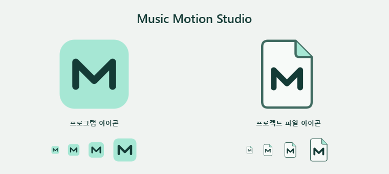

# Music Motion Studio — Studio UI

편집기와 대화상자는 하나의 다크 전용 스타일을 공유한다.

- 배경 `#202224`, 패널 `#292C2E`, 입력 영역 `#222527`, 캔버스 작업면 `#191C1E`.
- 기본 글자 `#ECEEED`, 보조 글자 `#ADB3B5`, 강조색 `#B4CDC3`. 선택 영역·경고·오류도 공통 토큰을 사용한다.
- 기본 UI 글꼴은 Segoe UI / 맑은 고딕 13px. 제목 21px, 보조 탐색 12px로 구분한다. 사용자 캔버스 글꼴은 별개다.
- 탭은 밑줄로 현재 위치를 표시하고, 패널은 그림자와 중첩 카드 대신 구분선을 쓴다.
- 입력창과 버튼은 4px 안팎의 모서리와 32–36px 안팎의 실제 높이를 기준으로 한다. 강조색 채움은 주요 실행 버튼에 사용한다. 배지와 프리셋 버튼은 작은 사각형으로 통일한다.
- 키보드 포커스, 선택, 비활성, 오류 상태를 구분한다.
- 색상 선택기의 미리보기, 작품 내용, 경고·오류·진행 상태는 의미에 맞는 색상을 유지한다.

공통 스타일은 `app/ui/design_system.py`와 `app/ui/studio.qss`,
기본 동작 아이콘은 `app/ui/studio_icons.py`에서 관리한다.
새 대화상자에 전체 스타일을 다시 정의하지 말고 공통 위젯 규칙과 객체 이름을 재사용한다.
컬러 스와치처럼 내용 자체를 보여주는 경우에만 로컬 스타일을 사용한다.

제품 이름은 **Music Motion Studio(뮤직 모션 스튜디오)**이다. 제품 아이콘은 민트
`#A6E7D4`와 짙은 녹색 `#143B36`의 M 심볼을 공유하며, 프로젝트 파일은 문서
윤곽으로 구분한다. 그림자·그라데이션·작은 글자를 사용하지 않는다.
원본은 `app/resources/app_icon.svg`, `app/resources/project_file_icon.svg`이고,
`python tools/generate_app_icon.py`로 PNG와 16~256px 10개 크기의 Windows ICO를 생성한다.

오른쪽 속성 패널의 연속 값은 슬라이더와 숫자 입력을 한 행에 제공한다. 너비·높이,
회전, 배율, 불투명도, 모서리, 글자 크기, 필터와 그림자 강도가 대상이다. 슬라이더는
자주 쓰는 실용 범위에 맞추고 숫자 입력은 전체 모델 범위를 유지한다. 좌표와 레이어
순서는 정확한 숫자 편집이 더 적합하므로 숫자 입력만 사용한다.

앱 설정에는 라이트/자동 테마 선택지를 노출하지 않고 다크 스튜디오 테마만 사용한다.
이전 설정의 light/auto 값은 dark로 정규화된다. 예전 프로젝트의 theme 메타데이터는
그대로 왕복 저장해 파일 호환성은 유지한다. 기존 작품의 색상은 바꾸지 않으며, 새
기본 프로젝트의 시작 디자인만 차분한 배경과 얇은 진행선으로 변경했다.

기능 흐름과 키보드 단축키는 유지한다. 미리보기는 하단 미리보기 탭(Ctrl+Alt+3)에서 열고,
상단 도구 모음의 강조 버튼은 내보내기(Ctrl+E) 하나만 둔다. 주요(primary) 버튼은 대화상자의
기본 버튼이 되어도 강조색을 유지한다. Qt 표준 버튼·파일 대화상자는 UI 언어의 Qt 번역을 사용한다.
소스 영역의 기본 너비는 300px, 속성 영역은 380px, 하단 패널 높이는 240px이며 기존 사용자의
저장된 배치는 유지한다. 기준 값은 `MainWindow._DEFAULT_*_PANEL_*` 상수이다.

배포 시 `studio.qss`와 체크 표시 SVG를 PyInstaller 데이터에 포함한다.
Qt offscreen 캡처는 `python tools/capture_ui_audit.py`로 생성한다.
결과는 `build/ui-refresh/audit/`에 저장하며 실제 GPU·Windows DPI 배율별
실행 결과를 대신하지 않는다.

화면별 점검 범위:

- 시작: 제품 표시와 새 작업은 왼쪽 레일, 최근 프로젝트는 오른쪽 목록. 빈 목록에는 안내만 표시하고 삭제·열기 버튼을 감춘다. Enter는 빈 목록에서 새 프로젝트를 만든다. 목록이 있으면 선택한 프로젝트를 연다. 긴 이름·경로는 말줄임표와 툴팁으로 표시한다.
- 편집기: 요소·프로젝트 콘텐츠·레이어, 플레이리스트·타임라인·미리보기, 속성 패널. 캔버스 상단에 화면 맞춤과 격자 도구를 둔다. 요소 목록의 중첩 배경과 반복 구분선을 제거했다.
- 속성: 17개 요소 종류의 속성 페이지 136개를 렌더링한다. 작품의 색상 선택·미리보기는 실제 값을 표시한다.
- AutoMix: 타임라인의 A/B 의미 색상은 유지한다. 13px 글자에 맞춰 속성 기본 너비를 368px로 조정했다. 최소 창에서 한국어·영어 컨트롤이 들어가는지 기존 테스트로 확인한다.
- 대화상자: 설정, 프로젝트, 곡 정보, 메타데이터, 가사 검색·편집·비교·스타일·애니메이션, 색상, 프리셋, 영상, 미리보기, 내보내기, FFmpeg, 업데이트, 도움말, 안내, 오류 보고를 포함한 39개 전체. 탭, 목록·표, 기본·비활성·선택·포커스·오류 상태를 공통 스타일로 처리한다.

검증 도구는 대화상자 클래스를 소스에서 수집해 누락을 검사한다. 현재 실행은
총 204개 PNG를 생성했고 대화상자 누락은 0개다. 화면별 목록과 크기는
`build/ui-refresh/audit/manifest.json`에서 확인할 수 있다.
사용자 설정과 미디어는 임시 경로로 격리한다. 실제 분석·영상 내보내기·다운로드는
시작하지 않으며, 미디어 플레이어의 로컬 파일 확인은 수행될 수 있다.

배포 명세에서 외부 Poppler 도구의 `icuuc.dll`이 수집되는 경우를 제외한다.
이 DLL은 Windows Qt가 사용하는 시스템 ICU와 이름이 같지만 호환되지 않아
앱 시작 전에 DLL 로딩 오류를 일으키는 것을 재현했다.

UI 관련 회귀 검증은 286개 테스트 통과(실패·오류 0개). 시작·제품 표시·소스 잠금 관련
추가 확인 10개도 통과했다. 테스트 로그는 `build/ui-refresh/verified-tests.log`와
`build/ui-refresh/final-checks.log`에 저장한다.
