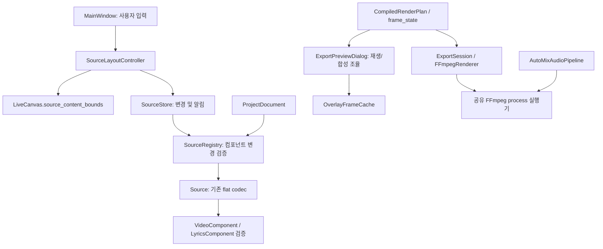

# 2026-10-26 아키텍처 리팩터링

## 기준과 범위

원격 `main`과 로컬 HEAD가 같은 `b870633e80478721dd1916ec9f8bd57d3d9bce80`인지 GitHub API로 확인했다. 기존 graphify 그래프를 탐색한 뒤 실제 소스와 호출부를 다시 읽었다. 그래프 탐색 예산은 2,200 tokens이며 실제 API 토큰 비용은 CLI에서 제공하지 않았다. 새 의존성 계측은 Python AST의 절대 import를 사용한다. `TYPE_CHECKING`은 제외하지만 함수 안의 지연 import는 포함하므로, 정적 순환 연결을 실행 시 순환 import 오류로 해석하면 안 된다.

다른 작업자가 수정하던 `SourceItem`, export 캡처, `ExportSession`, bounded pipeline, Canvas pipe, static video stream과 관련 성능 문서/테스트는 보존했다. 아래 변경과 별개로 이 파일들이 같은 작업 트리에 존재한다. 따라서 전체 테스트는 작업 트리의 통합 상태에 대한 결과이며, 다른 작업자의 개선 효과를 이 리팩터링의 성과로 계산하지 않는다.

UI/기능 추가, 타임라인 V2, 전문 멀티트랙 편집, 신규 의존성, 저장 스키마 버전 변경은 없다.

## 전체 구조와 실제 의존성

260개 Python 모듈, 내부 절대 import 861개를 확인했다. 상세 호출 방향은 [의존성 계측 JSON](benchmarks/2026-10-26-refactor-dependencies.json)에 있다. `Source`는 52개 모듈, `PlaylistTrack`은 43개, `CompiledRenderPlan`은 21개 모듈에서 사용한다. 이 공용 모델의 저장 필드와 시간 계약을 한 번에 바꾸는 방식은 위험이 크다.

| 영역 | 현재 책임 | 유지할 경계 |
|---|---|---|
| `ui`, `dialogs`, `widgets`, `inspector`, `layers` | 입력, 배치, 사용자 메시지 | 화면이 소유하는 Qt 객체는 GUI 스레드에 둔다 |
| `controllers` | 편집/저장/분석/미리보기/export 작업 순서, 취소 | 새 작업은 필요한 서비스와 데이터만 받는다 |
| `services` | 프로젝트 IO, 미디어, 설정, history, store | 저장 정책과 알림을 painter/decoder에서 처리하지 않는다 |
| `models`, timeline compiler/render plan | 직렬화, 검증, 재생 시간 의미 | widget/renderer를 import하지 않는다. 기존 timeline panel은 UI 예외다 |
| `automix` | 분석 provider/cache, 구조 분석, 계획, 오디오 DSP | 분석 결과와 의사 결정, FFmpeg 실행을 구분한다 |
| `canvas`, `preview`, `animation` | scene, 프레임 상태 평가, 합성, 캐시 | 프레임 캐시가 player나 MainWindow를 참조하지 않는다 |
| `renderer`, `ffmpeg`, `video` | filter graph, encode/mux, 프로세스 IO, decode/filter | 작업 취소와 프로세스 회수를 공통 경계에서 보장한다 |

가장 큰 정적 순환 묶음은 분석 service/cache, 구조 분석 service/cache, AutoMix workflow, FFmpegRenderer, lyrics alignment service, playlist service의 8개 모듈이다. 이 연결은 기존의 지연 import를 포함한다. 이를 해소한다는 이유로 별도 분석 시스템이나 render plan을 만들지 않았다.



## 적용한 변경

### 소스와 저장

- `VideoComponent.validate()`가 영상 경로, 반복/시간 모드, 속도, 채도, cycle count와 seed 검증을 소유한다. `LyricsComponent.validate_styles()`가 행/역할별 가사 타이포그래피 검증을 소유한다. `Source.from_dict()`는 기존 codec 진입점으로 남아 이 검증을 호출한다. 비활성 필드도 저장돼 있는 flat 형식이므로 다른 소스 유형에서도 기존과 같이 검증한다.
- `SourceRegistry.component_changes()`가 컴포넌트 snapshot 편집, 기존 키 변환, 등록 codec을 통한 검증, 실제 변경 필드 추출을 맡는다. `SourceStore.update_component()`는 반환된 변경을 한 번에 반영하고 알림을 보낸다. 실패하면 원본 모델과 알림에 변화가 없다. 변경하지 않은 legacy 필드의 정규화 결과도 덮어쓰지 않는다.
- 잘못된 component 등록은 사용 시점 이전에 거부한다. 기존 renderer/Inspector 등록 경로와 Qt 없는 model 사용은 유지한다.
- 프로젝트 버전의 bool/실수/잘못된 문자열을 거부한다. 예전 `int(1.9)`와 `int(True)`는 지원 버전 1로 잘못 읽혔다. 정수 1/2, 버전 생략, 기존에 읽던 정수 문자열은 계속 지원한다. 기존 파일/프리셋 작성기는 정수 버전을 출력한다.

### UI와 미리보기

- MainWindow의 nudge/가운데 배치/정렬/동일 간격 계산을 `SourceLayoutController`로 옮겼다. 이 Controller는 store와 경계 조회 함수만 받으며 MainWindow, UI widget, 전역 설정에 의존하지 않는다.
- `LiveCanvas.source_content_bounds()`는 회전·배율이 적용된 scene 좌표를 반환한다. 배치 계산은 Canvas의 내부 `_items` 사전을 읽지 않는다. 기존 단축키/메뉴와 호출 메서드는 같은 Controller로 연결된다.
- `OverlayFrameCache`가 트랙/효과 집합/프레임별 이미지, 표시하던 프레임의 대체 정책, 프레임 창 정리, 무효화 revision을 소유한다. Dialog는 playhead, worker generation, 취소, 합성을 조율한다. 메모리 계측 도구도 새 캐시의 이미지 iterator를 사용한다.
- 정확한 프레임 → 마지막 표시 프레임 → 가장 가까운 이전 프레임 순서를 보존했다. 다른 트랙이나 같은 개수의 다른 효과 집합으로 프레임을 재사용하지 않는다. AutoMix 중 캐시 정리는 들리는 트랙이 아닌 **화면에 그리는 트랙**의 시간을 기준으로 유지한다.

### 렌더 작업

- `app/ffmpeg/process.py`가 export와 AutoMix의 중복 stdout/stderr drain, 진행률 parsing, 취소, terminate/kill/wait, pipe close를 공유한다. 각각의 기존 `_run` 진입점과 예외 유형은 유지된다.
- AutoMix가 모든 progress/log 행을 끝없이 보관하던 동작을 제거했다. stdout은 바로 소비하며 stderr는 마지막 400행을 보관한다. export의 기존 진단 보관 한도와 같다.
- 진행률 콜백 예외가 reader 스레드에서 사라지는 문제를 수정했다. 예외를 호출자에게 전달하며 자식 프로세스를 종료·회수한다. 시작 전 취소된 작업은 프로세스를 만들지 않는다.
- 기존 `CompiledRenderPlan`, `frame_state`, `ExportSession`, filter graph와 encoder 인자는 재사용한다. 새 render plan이나 재생 backend를 만들지 않았다.

| 기존 대형 파일 | HEAD 줄 수 | 변경 후 줄 수 |
|---|---:|---:|
| Source | 674 | 615 |
| MainWindow | 5,543 | 5,465 |
| ExportPreviewDialog | 4,152 | 4,091 |
| FFmpegRenderer | 2,181 | 2,110 |
| AutoMixAudioPipeline 모듈 | 1,079 | 1,036 |

줄 수는 책임 이동의 범위를 나타내며 성능 지표는 아니다. 새 모듈은 한 책임씩 소유하고, 기존 구현과 동시에 실행되는 이중 시스템은 없다.

## 내부 확장 계약

1. 소스의 저장 필드는 현재 flat `Source` 형식을 유지한다. 새 속성을 추가할 때 `SourceComponent`의 metadata로 실제 저장 키를 연결한다. 컴포넌트 snapshot은 원본과 mutable 값을 공유하지 않는다.
2. 소스 유형의 factory/codec/component와 renderer/Inspector 연결은 기존 `SourceDefinition`/`SourceRegistry`를 사용한다. codec은 기존 flat 키를 입출력한다. 임의 Python 플러그인 로더는 도입하지 않는다.
3. 컴포넌트 편집은 `SourceStore.update_component()`를 사용한다. 모델 객체만 다루는 코드에서는 `SourceRegistry.component_changes()`로 변경을 검증할 수 있다. 키 추가 시 프로젝트·프리셋·history round trip을 함께 검사한다.
4. 새 배치 연산은 scene의 공개 geometry와 store 변경만 소비한다. 새 Controller가 MainWindow의 private 필드를 읽는 패턴을 복제하지 않는다.
5. 새 오디오/encode 경로는 공유 `run_ffmpeg()`를 사용하고 자신의 공개 예외로 변환한다. 진행률 콜백은 stdout reader에서 실행되므로 Qt 화면 변경은 signal로 전달한다.
6. 프레임 시간과 효과 전환은 기존 `CompiledRenderPlan`/`frame_state`에서 가져온다. 새 시각 효과를 추가할 때 preview/export 각각에 시간 계산을 복제하지 않는다.
7. 다음 저장 구조 변경 시 `CURRENT_VERSION`을 올리고 입력 버전별 migration과 fixture를 추가한다. 이번에는 layout 변화가 없으므로 새로운 migration registry를 만들지 않았다.

## 검증과 성능

- 프로세스 단위로 격리하는 기존 `scripts/run_tests.py`를 사용했다. 실제 FFmpeg 통합 검사도 활성화했다. **141/141개 모듈 통과, 총 1,833개 테스트 중 16개 skip, 614초**다. [전체 결과](benchmarks/2026-10-26-refactor-tests.json)는 모듈별 테스트/skip 수와 시간을 포함한다.
- 새 회귀 검사는 독립 컴포넌트 검증, Registry의 원자성·등록 codec 사용, 손상된 프로젝트 버전, MainWindow 없는 배치 Controller, 캐시 전환·메모리 창·무효화, 실제 subprocess pipe drain/취소/콜백 오류/종료를 다룬다.
- [HEAD와 실제 출력 비교](benchmarks/2026-10-26-refactor-equivalence.json)는 모든 17개 소스의 저장 값 일치와, CPU H.264 320×180/12fps/2초 영상의 디코딩된 RGB·PCM 해시 일치를 확인한다. 컨테이너 파일 자체의 해시는 메타데이터 차이가 있을 수 있으므로 비교 기준으로 쓰지 않는다.
- `tools/architecture_refactor_benchmark.py`는 checkout을 바꾸지 않고 HEAD의 이전 codec/프로세스 메서드를 로딩해 비교한다. warm-up 후 교대로 실행하여 소스 decode와 짧은 실제 렌더의 표본·중앙값을 저장한다. 이 작은 측정을 전체 프로젝트나 GPU 성능 향상으로 해석하지 않는다.
- 최종 교차 측정의 중앙값은 공유 프로세스 실행 **45.77 → 45.17ms**, 2초 영상 전체 렌더 **358.49 → 362.33ms**다. 초기 짧은 렌더 표본은 동시 작업/실행 변동으로 더 큰 차이가 나서 프로세스 단독 측정을 추가하고 재측정했다. 렌더 속도 개선으로 보고하지 않는다. 실제 FFmpeg 취소 완료는 **264ms**였다.
- 340회 소스 decode는 **17.61 → 21.78ms**로 증가했다(소스당 약 **12µs** 추가). 영상 검증용 detached snapshot 생성 비용이 추가되며, 프레임 paint 경로에는 들어가지 않는다. 대형 프로젝트의 로드 비용은 후속 계측 대상이다.
- [실미디어 CPU 미리보기](benchmarks/2026-10-26-refactor-preview.json)는 영상+한/영 가사, 640×360/30fps, warm-up 2초 후 3초 동안 **29.40fps**, 프레임 간격 p95 **41.10ms**, queue backlog peak **0**을 기록했다. 새 캐시 메모리 계측 경로도 실행했다. 이는 변경 후 짧은 smoke 측정이며 전후 개선율이나 장시간 안정성 근거는 아니다.
- UI 테스트의 기본 sandbox TEMP 아래에서는 언어 파일을 만들지 못해 초기 실행이 정지했다. 작업 공간 안에 별도 TEMP/TMP/TMPDIR을 지정해 다시 실행했으며 사용자 프로젝트·설정 경로를 사용하지 않는다.

재현 예시(PowerShell, 저장소 루트):

```powershell
New-Item -ItemType Directory -Force work/architecture-test-temp | Out-Null
$env:TEMP = (Resolve-Path work/architecture-test-temp).Path
$env:TMP = $env:TEMP
$env:TMPDIR = $env:TEMP
$env:PLAYLIST_CANVAS_TEST_FFMPEG = (Get-Command ffmpeg).Source
.build-venv312/Scripts/python.exe scripts/run_tests.py --timeout 300 --report work/refactor-tests.json
.build-venv312/Scripts/python.exe tools/architecture_refactor_benchmark.py
```

## 남은 기술 부채와 검증 한계

이 절은 첫 단계 완료 시점의 부채다. 이후 dirty/change serial, 복원 잠금과 자동 저장 worker 소유권은 [편집 세션 후속 작업](refactor-session-2026-10-26.md)에서 분리했다.

- Source는 여전히 flat 호환 모델이다. 영상과 가사 스타일 외의 검증, legacy migration과 일부 효과 계산은 남아 있다. 다음 기능을 수정할 때 해당 컴포넌트로 옮기는 방식으로 진행한다. 전체 모델을 nested 저장 구조로 한 번에 전환하지 않는다.
- 기존 Project/History/Preview/Export Controller에는 MainWindow private 상태에 대한 의존성이 남아 있다. 이번에는 실제 배치 작업 경계부터 독립시켰다. 다음 분리 대상은 프로젝트 dirty/change serial과 preview audio handoff의 소유권이며, 호환 wrapper만 추가하는 방식은 피한다.
- ExportPreviewDialog의 player/decoder/합성 조율, FFmpegRenderer의 오디오 준비·정규화·인코딩 정책은 아직 크다. 다른 작업자의 export 변경과 겹치는 영역은 재작성하지 않았다.
- 화면별 decoder/worker의 Qt 소유권과 기존 `qt_worker_lifecycle` 계약을 유지했다. decoder 전체를 별도 backend로 교체하거나 GUI scene render를 worker로 옮기지 않았다.
- 선택 설치가 필요한 PyTorch Beat This!/Sonara 실모델 검사, 장시간 soak, GPU 드라이버별 검증과 배포 패키지 재빌드는 이번 검증 범위에 포함하지 않는다. 실제 FFmpeg CPU 렌더와 짧은 실미디어 미리보기 검사는 전체 테스트에 포함된다.
