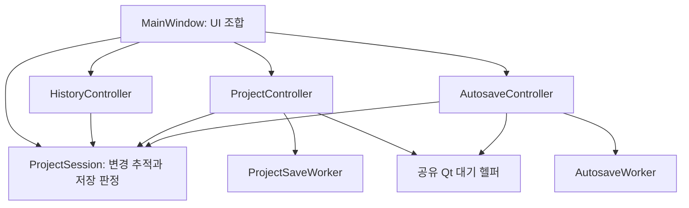

# 편집 세션과 worker 소유권 분리 — 2026-10-26 후속 작업

## 범위

[첫 리팩터링](refactor-2026-10-26.md) 이후 같은 작업 트리에서 이어서 적용했다. 다른 작업자의 export 캡처/렌더 변경과 첫 단계의 컴포넌트·캐시·프로세스 실행기 변경을 보존한다. 이번 단계는 프로젝트 편집 상태와 저장 worker의 소유권에 집중한다.

새 파일은 40줄의 `app/services/project_session.py`와 해당 회귀 검사다. 프로젝트 JSON, `.pvsproj`, 프리셋, `CompiledRenderPlan`, 렌더 인자와 UI 구성에는 변경이 없다.

## 상태 소유권

| 이전 MainWindow 필드 | 현재 소유자/계약 |
|---|---|
| `_project_dirty` | `ProjectSession.dirty` |
| `_project_change_serial` | `ProjectSession.change_serial`, `mark_changed()`, `mark_saved()` |
| `_history_ready` | `ProjectSession.ready` |
| `_history_restoring` | `ProjectSession.suspend_changes()`의 중첩 카운터 |
| `_history_applying` | `HistoryController.applying` |
| `_autosave_worker` | `AutosaveController.worker` |

MainWindow는 하나의 세션을 만들고 Project/History/Autosave Controller에 명시적으로 전달한다. 이 Controller들이 변경 상태를 얻기 위해 MainWindow private 필드를 참조하지 않는다. 이전 필드에 대한 호환 property나 이중 상태는 추가하지 않았다. 모든 앱 호출부, 테스트, 도움말 캡처·워크플로/pipe 벤치마크 도구를 새 경계로 연결했다.

`ProjectSession`은 Qt와 UI를 import하지 않는다. GUI 스레드에서 변경하고 worker에는 snapshot의 정수 serial만 전달한다. 영구 프로젝트 모델과 별개인 실행 상태이며 `ProjectDocument.to_dict()`에 들어가지 않는다. 상태 변경 알림 시스템이나 추가 Controller 프레임워크도 만들지 않았다.

## 동작과 안정성

- 변경을 기록할 수 있는 조건은 `session.tracking_changes` 한 곳에서 결정한다. 초기화 전이나 복원 중에는 history commit과 자동 저장을 시작하지 않는다. 따라서 복원 도중 Qt 이벤트를 처리하더라도 부분적으로 적용된 문서를 자동 저장하지 않는다.
- `suspend_changes()`는 `try/finally`로 중첩 깊이를 복구한다. 내부 Canvas resize/fit이나 실패한 내부 복원이 끝났다는 이유로 바깥 프로젝트 복원의 변경 추적 잠금까지 풀리지 않는다.
- `mark_saved(snapshot_serial)`은 실제 저장한 snapshot 이후 편집이 더 있었는지 검사한다. 저장 중 추가한 편집은 계속 dirty 상태로 남는다. 기존 저장 동작을 한 메서드에 모았으며 새 저장 형식을 만들지 않았다.
- 실행 취소의 재진입 상태는 HistoryController가 소유한다. 복원 실패 후 UI 갱신과 이 상태를 해제하면서 바깥 변경 추적 잠금은 보존한다.
- 자동 저장의 생성·완료·해제는 AutosaveController가 소유한다. MainWindow의 종료와 두 업데이트 인계 경로는 `wait_for_pending()`만 호출한다. worker 참조를 직접 읽고 `wait()`하던 세 군데를 제거했다.
- `wait_for_qthread()`는 기존 `qt_worker_lifecycle`의 nested event loop와 50ms 완료 확인을 재사용한다. 이미 종료 신호가 발생한 worker도 확인하므로 `isRunning()` 검사와 signal 연결 사이의 경합으로 영원히 기다리지 않는다.
- 필수 수동 저장도 이 공통 대기를 사용한다. 대기 중 paint/완료 signal은 처리하며 사용자 입력 이벤트는 제외한다. 자동 저장 종료는 기존의 **finished handler 분리 → native join → 즉시 Qt 삭제** 순서를 유지한다. Windows에서 검증된 `DeferredDelete` 처리는 여전히 한 파일에만 있다.
- 명시적인 자동 저장 대기 중에는 완료 콜백이 소유권을 다시 바꾸지 못하게 한다. disconnect 이전에 큐에 들어온 오래된 완료 콜백도 다른 작업의 진행률을 끝내거나 이미 해제한 worker를 다시 삭제하지 않는다. 중첩 대기는 같은 worker의 완료를 기다리고 삭제는 바깥 소유자가 한 번만 한다.

현재 관련 import와 크기는 [후속 의존성 기록](benchmarks/2026-10-26-refactor-session-dependencies.json)에 있다. MainWindow는 첫 단계의 5,465줄에서 5,450줄이 됐다. 줄 수보다 여섯 개 실행 상태의 소유자가 명확해진 점이 이번 변경의 핵심이다.

## 검증

- `test_project_session`: 중첩 복원/예외, 저장 중 편집, 창별 상태 격리, MainWindow 상태 필드가 없는 view에서 history 동작, 복원 중 자동 저장 차단, 실패한 history 복원 이후 잠금/재진입 해제.
- `test_qt_worker_lifecycle`: 이미 완료된 worker, 대기 중 GUI 타이머·기존 완료 handler 동작, 완료 시 스스로 삭제하는 worker 40회 반복, 기존 즉시 종료/삭제 순서.
- 이 Qt 생명주기 모듈을 별도 프로세스에서 20회 반복해 **20/20회, 100개 검사 통과**를 확인했다. 그 안의 빠른 생성·완료·삭제는 총 800회다. [반복 결과](benchmarks/2026-10-26-refactor-session-lifecycle-stress.json)를 보존한다.
- 실제 MainWindow: 자동 저장의 GUI 응답과 중첩 대기, 중복 저장 방지, 대기 전에 이미 큐에 들어온 완료 콜백, 중첩 Canvas resize에서의 변경 추적 잠금, 저장 중 새 편집 보존과 필수 저장 성공.
- 기존 architecture 검사에 여섯 개 MainWindow 상태 필드의 재도입 방지를 추가했다.
- 실제 FFmpeg 통합 검사를 활성화해 전체 모듈을 검사했다. 수정 후 재검증을 포함한 최종 결과는 **142/142개 모듈 통과, 총 1,844개 테스트 중 16개 skip**이다. [후속 회귀 검사 JSON](benchmarks/2026-10-26-refactor-session-tests.json)에 각 모듈을 검증한 실행 기록의 출처를 포함한다. 별도 Qt 반복 검사 100개는 이 1,844개에 합산하지 않았다.

첫 전체 실행에서는 기존 스크롤 테스트가 한 번 실패했다. 이 테스트가 서비스 대신 widget에 직접 넣은 40개 가짜 행을 160ms 예약 갱신이 지울 수 있었다. fixture를 `ProjectContentService`에 등록하고, 필터를 명시한 뒤 갱신 후 40개 항목과 스크롤 범위를 확인하도록 고쳤다. 지연 시간을 늘리거나 검사를 완화하지 않았다. [최초 전체 실행](benchmarks/2026-10-26-refactor-session-initial-tests.json)은 141/142개 모듈 통과였으며, 이후 해당 창 모듈의 [86개 검사 재실행](benchmarks/2026-10-26-refactor-session-main-window-recheck.json)은 모두 통과했다. 그 사이 production 코드는 변경하지 않았다. 최종 모듈 결과는 이 재검증을 반영한 집계이며 단일 실행의 무실패 기록으로 표현하지 않는다.

### 대기 중 GUI 응답 측정

[원시 측정](benchmarks/2026-10-26-refactor-session-wait.json)은 실제 AutosaveWorker와 atomic recovery write를 사용하되, 쓰기 시작을 의도적으로 200ms 지연했다. 10ms GUI 타이머로 세 쌍을 번갈아 측정했다.

| 경로 | 대기 시간 | 대기 중 GUI 타이머 | 최대 GUI 간격 |
|---|---:|---:|---:|
| 이전의 native `QThread.wait()` | 205.2–207.0ms | 0회 | 205.2–207.0ms |
| Controller의 새 drain | 205.0–206.3ms | 20회 | 10.8–11.5ms |

모든 표본에서 복구 파일을 정상 작성했고 worker를 해제했다. 쓰기 속도를 높였다는 측정이 아니라, 필수 쓰기를 끝까지 기다리면서 이벤트 처리를 유지한다는 확인이다. JSON 인코딩의 GIL 비용이나 대형 프로젝트 snapshot 생성 시간은 이 fixture가 측정하지 않는다.

## 남은 경계

- 기존 Controller는 여전히 MainWindow의 문서/UI adapter, 일부 timer와 widget을 사용한다. 이번에는 편집 상태 정책과 worker 소유권을 분리했다. 모든 Controller의 MainWindow 의존성이 사라졌다고 보고하지 않는다.
- 다음 독립 대상은 미리보기 오디오의 준비/인계와 실패 시 자원 소유권, 프로젝트 path/문서 적용 adapter다. Source의 잔여 검증과 큰 미리보기/렌더 정책도 첫 보고서의 부채로 남는다.
- live model snapshot은 GUI 스레드에서 만든다. mutable Qt 모델을 복사 없이 worker에 넘기지 않았다. 대형 snapshot 비용과 장시간 GPU/실모델/배포 패키지 검증은 이번 단계의 측정 범위가 아니다.
